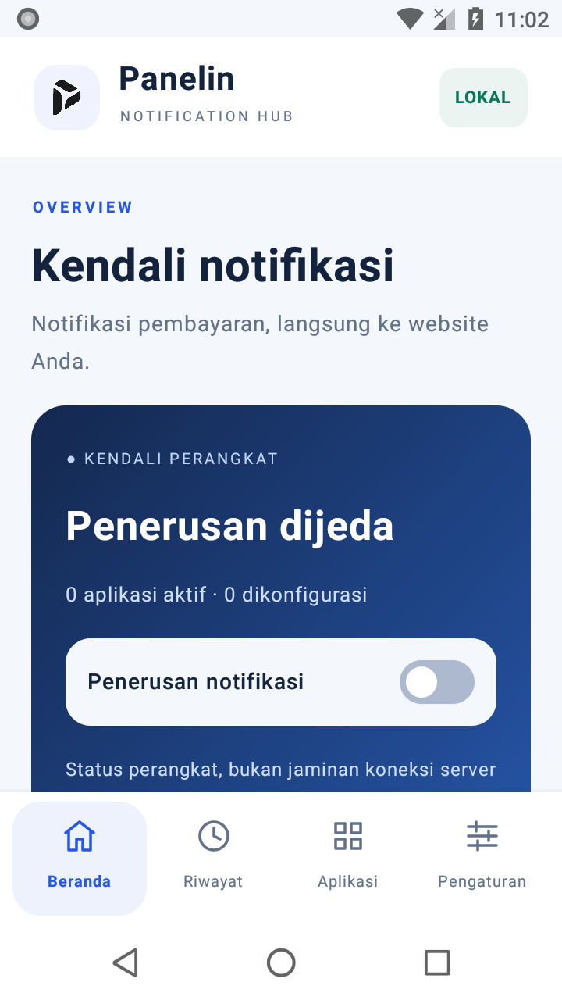
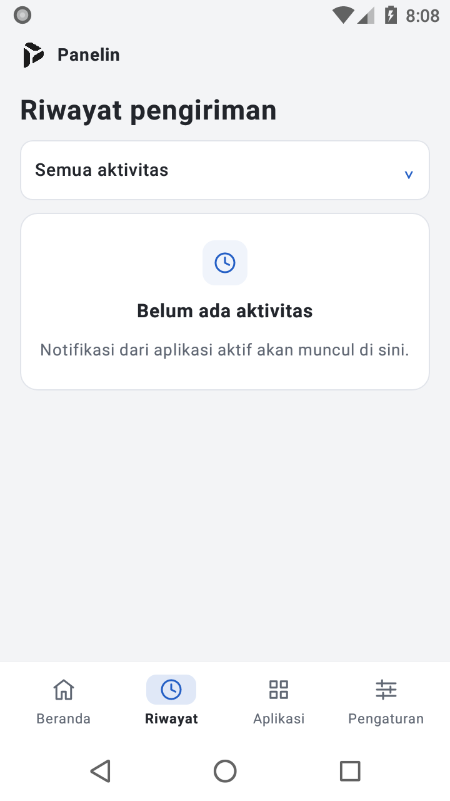

# Panelin Notifikasi

Aplikasi Android pendamping untuk pemilik/admin website **Panelin**. Teruskan notifikasi pembayaran dari HP Anda langsung ke webhook website Anda untuk membantu konfirmasi deposit otomatis.

**Dipasang pada HP pemilik website, bukan HP pelanggan yang melakukan deposit.** Setiap client mengatur aplikasi sumber, URL, dan token sendiri. Tidak ada endpoint bawaan, server perantara Panelin, iklan, atau telemetri terpusat.

Kandidat lokal v1.2.0 menggunakan Jetpack Compose; belum dipublikasikan. Tautan dan screenshot rilis publik di bawah masih v1.0.1.

## Unduh aplikasi

**[Unduh APK v1.0.1 — uji terbatas](https://github.com/herusuandana/panelin-notifikasi/releases/tag/v1.0.1)**

Pada bagian **Assets**, pilih `panelin-notifikasi-1.0.1-release.apk`. File `.sha256` tersedia untuk pemeriksaan integritas. Jangan memilih **Source code** jika hanya ingin memasang aplikasi.

- Minimum **Android 8.0**; package `id.panelin.notifikasi`.
- APK ditandatangani dengan sertifikat release tetap, bukan debug key.
- Versi ini untuk **uji terbatas**, belum dinyatakan siap produksi. Pembayaran DANA nyata sampai kredit saldo dan ketahanan pada HP client belum diuji end-to-end. Lihat [hasil pengujian](QA-RESULTS.md).
- Semua versi tersedia di [GitHub Releases](https://github.com/herusuandana/panelin-notifikasi/releases). Belum ada pembaruan otomatis di dalam aplikasi.

<p>
  
  
</p>

Jika v1.0.0 langsung tertutup saat dibuka pada Android 15, v1.0.1 memperbaiki satu defect urutan inisialisasi window; crash pada HP pelapor belum dikonfirmasi terselesaikan melalui log atau tes perangkat. Pasang sebagai pembaruan **tanpa uninstall**; package dan sertifikat tetap sama.

## Fitur

- Daftar aplikasi terpasang dengan pencarian dan kendali per sumber.
- URL webhook serta token terpisah untuk setiap aplikasi sumber.
- Pemantauan melalui akses notifikasi Android, bukan login ke dompet.
- Antrean persisten terenkripsi dengan Android Keystore dan retry terbatas.
- Antrean lama ditahan jika tujuan/token berubah; tidak dialihkan diam-diam.
- Riwayat membedakan `credited`, `duplicate`, `ignored`, `unmatched`, `ambiguous`, dan `review`.
- Panduan izin, baterai, autostart, versi, dan catatan pembaruan.

## Penyiapan client

1. Unduh APK dari tautan rilis di atas dan izinkan pemasangan dari sumber tersebut bila Android memintanya.
2. Buka aplikasi dan baca penjelasan privasi. Pada Android tertentu, aplikasi hasil sideload perlu **Allow restricted settings / Izinkan setelan terbatas** di info aplikasi sebelum akses notifikasi dapat diaktifkan. Nama menu tergantung perangkat; aplikasi tidak melewati pembatasan Android.
3. Di website Panelin Anda, buka metode pembayaran Manual yang mendukung konfirmasi notifikasi. Aktifkan fiturnya, lalu salin URL callback dan token penerima.
4. Pada tab **Aplikasi**, pilih sumber pembayaran yang benar, tekan **Atur penerusan**, isi URL HTTPS serta token, dan berikan persetujuan. Format URL: `https://DOMAIN-ANDA/callback/notification/ID_METODE`, dengan ID numerik.
5. Melalui **Beranda**, berikan akses notifikasi di pengaturan Android, izinkan notifikasi status, dan aktifkan penerusan. Tinjau baterai/autostart sesuai merek HP.
6. Sebelum penggunaan operasional, ikuti [checklist uji perangkat](TESTING.md). Untuk pembayaran nyata yang disetujui client, cocokkan hasil di Riwayat dengan invoice, mutasi dompet, dan saldo website.

**Jangan masukkan PIN, password, atau OTP DANA.** Token di sini adalah token webhook dari pengaturan metode pembayaran website, bukan kredensial dompet atau akun admin.

## Kompatibilitas dan batas penting

Preset backend yang diperiksa adalah **DANA Bisnis**: package `id.dana`, judul `Pembayaran Masuk`, teks `Rp{nominal} diterima DANA Bisnis.`. Memilih aplikasi lain tidak otomatis membuat formatnya didukung: parser backend harus cocok dengan notifikasi asli. DANA pribadi atau format berbeda perlu diverifikasi tersendiri.

- **HTTP 200 bukan bukti kredit saldo.** Hanya outcome `credited` menyatakan server mengonfirmasi kredit.
- Status listener menunjukkan keadaan di HP, bukan kesehatan server atau keaslian dana masuk.
- Notifikasi bukan API resmi bank/dompet. Perangkat serta token harus dijaga; perangkat terkompromi dapat memalsukan klaim.
- Backend dapat menahan nominal historis untuk review atau menganggap pembayaran berulang dengan akun/package/judul/nominal identik sebagai duplikat. Android tidak mengubah pengaman tersebut.
- Doze, penghemat baterai, pembatasan OEM, dan force stop dapat menunda/menghentikan pemrosesan. Tidak ada jaminan berjalan tanpa gangguan selama 24 jam.
- Tidak ada tombol webhook pembayaran palsu untuk tes koneksi karena payload yang cocok bisa menambah saldo.

## Privasi dan bantuan

Baca [kebijakan privasi](PRIVACY.md), [catatan pembaruan](CHANGELOG.md), dan [hasil QA](QA-RESULTS.md). Bila HP hilang, rotasi token di website dan amankan perangkat.

Untuk bantuan, hubungi pengelola Panelin Anda atau [buat issue](https://github.com/herusuandana/panelin-notifikasi/issues) berisi versi aplikasi, Android, merek/model, dan langkah reproduksi. **Issue GitHub bersifat publik: jangan unggah token, isi notifikasi pembayaran, data pelanggan, database, atau kunci signing.**

## Untuk pengembang

UI Jetpack Compose dengan layanan native Kotlin (tanpa JavaScript atau WebView); JDK 17, SDK 35, Build Tools 35.0.0, Gradle Wrapper 8.11.1. Dependensi dan versi build ditetapkan di file Gradle.

```sh
git clone https://github.com/herusuandana/panelin-notifikasi.git
cd panelin-notifikasi
# Atur JAVA_HOME ke JDK 17 dan ANDROID_HOME ke Android SDK lokal.
./gradlew testDebugUnitTest lintRelease assembleDebug
python3 scripts/check-release.py
```

Untuk build release lokal, `python3 scripts/build-release.py` menjalankan unit test, lint, build, dan verifikasi signature. Skrip membuat identitas signing lokal sekali di `$HOME/.local/share/panelin-android-signing`, di luar repository. **Identitas baru tidak dapat memperbarui APK resmi.** Hanya pemelihara dengan kunci resmi yang dapat menandatangani pembaruan resmi; cadangkan kunci tersebut secara offline dan jangan mengunggahnya ke GitHub.

Hasil build berada di `dist/`; `python3 scripts/package-source.py` membuat arsip source tanpa cache, data lokal, atau keystore. SDK/helper emulator lokal dibahas di [TESTING.md](TESTING.md).

### Kontrak webhook

`POST /callback/notification/{ID_METODE}` dengan JSON `sign`, `pkg`, `title`, `text`, `bigtext`. Token hanya di body HTTPS; URL dengan query, fragment, userinfo, atau redirect tidak diizinkan. Backend menentukan pencocokan invoice dan kredit; aplikasi hanya meneruskan kejadian.

### Merilis pembaruan

Naikkan `versionCode` dan `versionName` di `app/build.gradle.kts`, lalu selaraskan `VERSION`, `CHANGELOG.md`, dan `app/src/main/assets/changelog.json`. Jalankan pemeriksaan serta QA, gunakan sertifikat release yang sama, dan unggah APK beserta checksum ke GitHub Releases. Client memasang pembaruan di atas versi lama; **jangan uninstall bila masih ada antrean**. Lihat [CHANGELOG.md](CHANGELOG.md) untuk riwayat versi.
